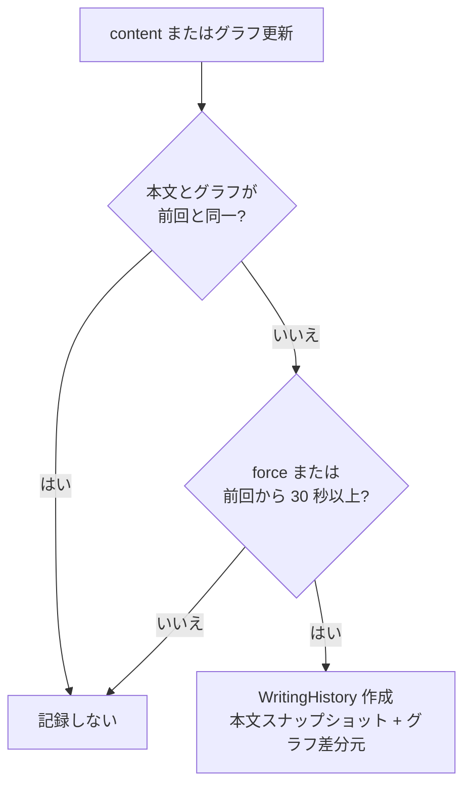

# 外部 Workspace REST API

外部 Web アプリ（例: SOS）が ArsTraverse の **執筆 Workspace** を同期するための REST エンドポイント。Tiptap 本文（`content`）、キュレトリアルコンテキスト、執筆履歴の取得・復元、共同編集者の追加を HTTP で行える。

MCP（`/api/mcp`）や TopicSpace 公開 REST API（`/api/topic-spaces/{id}`）とは別の統合面 — **認証必須** の執筆データ向け。

## 認証

[MCP 認証](./mcp-authentication.md) と同じ方式:

| 順位 | 方式             | ヘッダー                                  |
| ---- | ---------------- | ----------------------------------------- |
| 1    | アクセストークン | `Authorization: Bearer <mcp1....>`        |
| 2    | セッション       | ブラウザ Cookie `next-auth.session-token` |

トークンは `/mcp/authorize` で発行（**プラットフォーム** スコープで十分。TopicSpace 未作成でも Workspace API は利用可能）。外部 Web アプリ連携では `redirect_uri` + `EXTERNAL_OAUTH_REDIRECT_URIS` による OAuth 風コールバックも利用できる（詳細は [MCP 認証 — 外部 OAuth リダイレクト](./mcp-authentication.md#外部-oauth-リダイレクトweb-アプリ連携)）。

新規作成時、トークンに紐づくユーザーが Workspace の **所有者** になる。読み書きは、ログイン済み（有効なトークンまたはセッション）であれば所有者や共同編集者でなくてもできる。未認証は `401`。

## 識別子: `source` + `sourceKey`

| フィールド   | 説明                                                         |
| ------------ | ------------------------------------------------------------ |
| `source`     | 外部アプリ識別子（例: `sos`）                                |
| `sourceKey`  | アプリ内の一意キー（例: 記事 slug、外部 ID）                 |

DB 上は `@@unique([source, sourceKey])`。同一ペアは 1 Workspace にマップされる。

- **作成**: `PUT` で存在しなければ新規作成（所有者 = 認証ユーザー）
- **更新**: 認証済みユーザーが `content` 等を更新できる
- **論理削除後の復活**: 削除済み（`isDeleted: true`）の同一 `source`/`sourceKey` を `PUT` すると、認証済みユーザーが復活できる

GUI から作成した Workspace は `source` / `sourceKey` が `null` のため、この API の upsert キーには使えない。

## エンドポイント一覧

| メソッド | パス                                         | 説明                                              |
| -------- | -------------------------------------------- | ------------------------------------------------- |
| `GET`    | `/api/external/me`                           | 認証ユーザー情報                                  |
| `GET`    | `/api/external/workspaces`                   | `source` 単位の一覧、または 1 件取得              |
| `PUT`    | `/api/external/workspaces`                   | `source` + `sourceKey` による upsert              |
| `DELETE` | `/api/external/workspaces`                   | `source` + `sourceKey` で論理削除                 |
| `GET`    | `/api/external/workspaces/history`           | 執筆履歴一覧（GUI 向けプレビュー・グラフ差分）    |
| `POST`   | `/api/external/workspaces/history`           | 履歴から本文・グラフを復元                        |
| `POST`   | `/api/external/workspaces/collaborators`     | **所有者のみ** collaborator 追加                  |
| `GET`    | `/api/external/workspaces/usage-log`         | 1 Workspace の利用ログ（合成行あり）              |
| `GET`    | `/api/external/workspaces/usage-log-all`   | 複数 `source` 横断の利用ログ（カーソルページング） |
| `GET`    | `/api/external/workspaces/usage-activity`    | `source` 単位の活動タイムライン（集計用）         |
| `GET`    | `/api/external/workspaces/curation-history`  | グラフ整備履歴一覧（SOS 系 `source` 限定）        |
| `POST`   | `/api/external/workspaces/curation-history`  | 整備履歴の取り消し（最新保存が対象行のときのみ）  |
| `GET`    | `/api/external/drive/browse`                 | 連携 Drive フォルダの 1 階層一覧                  |
| `GET`    | `/api/external/drive/files`                  | フォルダ内の画像ファイル一覧                      |
| `GET`    | `/api/external/drive/files/{fileId}/content` | 画像バイナリ（`image/*` のみ）                    |

## GET `/api/external/me`

認証済みユーザーの公開プロフィールを返す。

```json
{
  "user": {
    "id": "clxxx...",
    "name": "Curator Name",
    "email": "curator@example.com",
    "image": "https://..."
  }
}
```

`email` は認証した本人のアドレスだけ返す。履歴の `changedBy` など、他のユーザーを含む応答には含めない。

## GET `/api/external/workspaces`

### クエリパラメータ

| パラメータ  | 必須 | 説明                                                         |
| ----------- | ---- | ------------------------------------------------------------ |
| `source`    | はい | 外部アプリ識別子                                             |
| `sourceKey` | 任意 | 指定時は 1 件取得。未指定時は `source` に属する一覧（`updatedAt` 降順） |

認証済みユーザーは、指定した `source` の Workspace を一覧・取得できる。該当なしは `404`（単件）または空配列（一覧）。

### レスポンス（単件）

```json
{
  "workspace": {
    "id": "clxxx...",
    "source": "sos",
    "sourceKey": "article-42",
    "name": "記事タイトル",
    "description": null,
    "status": "DRAFT",
    "content": { "type": "doc", "content": [ /* TipTap JSON */ ] },
    "curatorialContext": { "stance": "...", "extractionRules": {} },
    "createdAt": "2026-08-31T12:00:00.000Z",
    "updatedAt": "2026-08-31T12:30:00.000Z"
  }
}
```

### レスポンス（一覧）

```json
{
  "workspaces": [ /* ExternalWorkspaceDto[] */ ]
}
```

`status` は `DRAFT` | `IN_PROGRESS` | `REVIEW` | `PUBLISHED` | `ARCHIVED`。

## PUT `/api/external/workspaces`

`source` + `sourceKey` で upsert。本文更新時は執筆履歴を自動記録（下記「執筆履歴」）。

### リクエストボディ

| フィールド           | 必須 | 説明                                                         |
| -------------------- | ---- | ------------------------------------------------------------ |
| `source`             | はい | 外部アプリ識別子                                             |
| `sourceKey`          | はい | アプリ内一意キー                                             |
| `name`               | 任意 | 表示名。未指定時は既存値維持（新規は `sourceKey`）           |
| `description`        | 任意 | `null` でクリア可能                                          |
| `content`            | 任意 | TipTap doc JSON（`{ type: "doc", content?: [...] }`）        |
| `curatorialContext`  | 任意 | キュレトリアルコンテキスト（`stance`, `extractionRules`, `negativeArchive` 等） |
| `status`             | 任意 | `WorkspaceStatus` 列挙値                                     |
| `changeDescription`  | 任意 | 履歴に残す変更説明（既定: 「内容を更新しました」）           |
| `recordHistory`      | 任意 | `false` で履歴記録をスキップ（既定: `true`）               |

### レスポンス

```json
{ "workspace": { /* ExternalWorkspaceDto */ } }
```

### エラー

| HTTP | 条件                                                         |
| ---- | ------------------------------------------------------------ |
| 400  | `source` / `sourceKey` 欠落                                  |
| 401  | トークン・セッション無効。認証済みなら所有者でなくても更新できる |

## DELETE `/api/external/workspaces`

`source` + `sourceKey` で Workspace を **論理削除**（`isDeleted: true`）。既に削除済みでも `{ "ok": true }` を返す。該当ペアが一度も無い場合は `404`。

### クエリパラメータ

| パラメータ  | 必須 | 説明           |
| ----------- | ---- | -------------- |
| `source`    | はい | 外部アプリ識別子 |
| `sourceKey` | はい | アプリ内一意キー |

```json
{ "ok": true }
```

`PUT` で同一 `source` / `sourceKey` を送れば復活できる（上記「識別子」）。

## GET `/api/external/workspaces/history`

### クエリパラメータ

| パラメータ    | 必須 | 説明                    |
| ------------- | ---- | ----------------------- |
| `workspaceId` | はい | Workspace ID            |

最大 **50 件**（`createdAt` 降順）。

| フィールド | 説明 |
| ---------- | ---- |
| `preview` / `previousPreview` | TipTap 本文のプレーンテキスト要約（空白正規化、最大 160 文字） |
| `previousText` / `currentText` | 段落改行を残した全文。差分表示向け |
| `hasGraph` | この版にライブグラフのスナップショットがあるか |
| `graphSummary` | グラフ差分の短い要約（例: `+2ノード · −1関係`） |
| `graphDiff` | 追加・削除・更新されたノード／関係。変化がなければ `null` |

```json
{
  "histories": [
    {
      "id": "clhist...",
      "workspaceId": "clxxx...",
      "changeDescription": "内容を更新しました",
      "preview": "美術大学と美大生 相模原市は…",
      "previousPreview": "",
      "previousText": "",
      "currentText": "美術大学と美大生\n相模原市は美大生のまちです。",
      "hasGraph": true,
      "graphSummary": "+1ノード · +1関係",
      "graphDiff": {
        "nodes": [
          { "change": "added", "id": "n1", "name": "桶屋", "label": "Studio" }
        ],
        "relationships": [],
        "summary": {
          "addedNodeCount": 1,
          "removedNodeCount": 0,
          "updatedNodeCount": 0,
          "addedRelationshipCount": 0,
          "removedRelationshipCount": 0,
          "updatedRelationshipCount": 0,
          "metaChanged": false
        }
      },
      "createdAt": "2026-08-31T12:30:00.000Z",
      "changedBy": { "id": "...", "name": "...", "image": "..." }
    }
  ]
}
```

## POST `/api/external/workspaces/history`

履歴 1 件の保存時点の本文（`currentContent`）とグラフを Workspace に復元する。表示中の差分だけを打ち消すのではなく、その版のスナップショット全体へ巻き戻す。グラフは `currentGraph` を使う。`previousGraph` だけある行は、この版にグラフが残っていないものとして本文のみ戻す。両方無いレガシー行だけ、前後の履歴から当時のグラフを補う。それでもグラフが無い履歴は本文のみ戻す。復元操作自体も履歴に記録される（`changeDescription`: 「履歴から復元しました」）。

### リクエストボディ

```json
{
  "workspaceId": "clxxx...",
  "historyId": "clhist..."
}
```

### レスポンス

```json
{ "workspace": { /* 復元後の ExternalWorkspaceDto */ } }
```

## POST `/api/external/workspaces/collaborators`

共同編集者でなくても、認証済みユーザーは Workspace を読み書きできる。このエンドポイントで共同編集者を追加できるのは、これまでどおり **Workspace 所有者のみ**。

### リクエストボディ

| フィールド    | 必須 | 説明                                      |
| ------------- | ---- | ----------------------------------------- |
| `workspaceId` | はい | 対象 Workspace ID                         |
| `userId`      | 任意 | 追加するユーザーの ID（`userEmail` と排他） |
| `userEmail`   | 任意 | 追加するユーザーのメール（ArsTraverse 登録済み） |

所有者自身を collaborator に追加は `400`。対象ユーザー未登録は `404`。

```json
{
  "workspaceId": "clxxx...",
  "collaborator": { "id": "...", "name": "...", "image": "..." }
}
```

## 利用ログ・活動分析（SOS 等）

執筆履歴 API（`/history`）はプレビューと `graphDiff` 向け。外部アプリの **利用状況ダッシュボード** 向けには、本文の前後テキストと `graphEvents` を返す別系統のエンドポイントがある。

### GET `/api/external/workspaces/usage-log`

1 Workspace 分。`WritingHistory` 行に加え、30 秒スロットルで DB に残らなかった差分を **合成行** として挿入する（`expandUsageLogEntries`）。配列は **新しい順**。

| クエリ | 必須 | 説明 |
| ------ | ---- | ---- |
| `workspaceId` | はい | 対象 Workspace |
| `take` | 任意 | 1〜500（既定 500）。`truncated: true` でさらに古い行あり |
| `historyId` | 任意 | 指定時は一覧ではなく `{ "currentGraph": ... }` のみ（下記） |

**一覧レスポンス**（各 `histories[]` 要素）:

| フィールド | 説明 |
| ---------- | ---- |
| `previousText` / `currentText` | TipTap 本文のプレーンテキスト |
| `graphEvents` | ノード・関係の追加/更新/削除と `origin`（`manual` / `sketch` / `image` / `llm` 等） |
| `changedBy` | 実ユーザー。合成行は `id: "unrecorded"` または `id: "activity"`（活動 API 内部用） |

合成行の `id` 例:

| `id` | 意味 |
| ---- | ---- |
| `unrecorded:{olderId}:{newerId}` | 2 つの履歴行の間に残っていた変更 |
| `unrecorded:workspace` | 最後の履歴から現在の保存までの差分 |

`historyId` 付き GET は、その行の **変更後グラフ** を返す。合成行 ID も解釈する（`unrecorded:workspace` → ライブグラフ、`unrecorded:older:newer` → 新しい側行の `previousGraph`）。

### GET `/api/external/workspaces/usage-log-all`

複数 `source` をまたいで `WritingHistory` を **新しい順** にページング。エクスポート・横断レポート向け。

| クエリ | 必須 | 説明 |
| ------ | ---- | ---- |
| `sources` | はい | カンマ区切り（例: `sos,sos-research`）。重複は除去 |
| `take` | 任意 | 1〜5000（既定 2000） |
| `beforeCreatedAt` | 任意 | 次ページ用カーソル（`beforeId` と **セット** で指定） |
| `beforeId` | 任意 | 前ページ最古行の `id` |

**`usage-log` との違い**: 合成行（間隔・現在保存）は **含めない**。DB に記録された行だけなので、カーソルをまたいでも欠落しない。

```json
{
  "histories": [
    {
      "id": "clhist...",
      "workspaceId": "clxxx...",
      "source": "sos",
      "sourceKey": "article-42",
      "title": "記事タイトル",
      "changeDescription": "内容を更新しました",
      "previousText": "...",
      "currentText": "...",
      "graphEvents": [ { "kind": "node", "change": "added", "origin": "image", "id": "n1", "name": "..." } ],
      "createdAt": "2026-10-20T12:00:00.000Z",
      "changedBy": { "id": "...", "name": "...", "image": "..." }
    }
  ],
  "truncated": true,
  "nextBefore": { "createdAt": "2026-10-19T08:00:00.000Z", "id": "clhist-older" }
}
```

`truncated: true` のとき、次ページは `beforeCreatedAt` + `beforeId` に `nextBefore` を渡す。

### GET `/api/external/workspaces/usage-activity`

`source` に属する全 Workspace の利用ログを展開し、**活動がある行だけ** を時系列（新しい順）で返す。グラフは **追加** と `promoted` のみカウント（更新・削除は含めない）。

| クエリ | 必須 | 説明 |
| ------ | ---- | ---- |
| `source` | 任意 | 既定 `sos-research` |

各 `points[]`: `at`, `slug`（`sourceKey`）, `title`, `textAdded`, `manual`, `sketch`, `image`, `promoted`, `llm`, `unknown`。

## グラフ整備履歴（curation）

変更説明が **`グラフ整備` で始まる** `WritingHistory` のみ。ルート実装は `source` を `sos-research` と `sos-research-concept` に固定。

### GET `/api/external/workspaces/curation-history`

最大 80 件（サービス層の既定）。各要素に `graphSummary`（例: `+2ノード · −1関係`）、その Workspace の最新履歴 ID（`latestHistoryId`）を含む。

### POST `/api/external/workspaces/curation-history`

```json
{ "historyIds": ["clhist...", "clhist-2"] }
```

- 対象は整備履歴かつ上記 `source` の Workspace のみ
- **各 Workspace で、指定 ID がいまの最新履歴であること**（その後に別保存がある場合は `409`）
- 複数 ID は同一 Workspace 内の連続した整備バッチをまとめて 1 回で戻す用途。`previousGraph` からライブグラフと concept redirect を復元

## Google Drive（外部 API）

認証ユーザーの **Google Drive 連携**（リポジトリ画面で OAuth）が前提。未連携は `409` と `connected: false`。

| エンドポイント | 用途 |
| -------------- | ---- |
| `GET .../drive/browse?within=FOLDER_ID` | `within` 直下の子フォルダ・ファイル一覧（`folderId` 省略時は `within` 自体） |
| `GET .../drive/browse?within=...&folderId=...` | サブフォルダを 1 階層だけ開く（`folderId` が `within` の子でないとき `404`） |
| `GET .../drive/browse?within=...&fileId=...` | ファイルが `within` 配下か `{ "inside": true/false }` |
| `GET .../drive/files?folderId=...` | フォルダ内の画像メタデータ一覧 |
| `GET .../drive/files/{fileId}/content` | 画像本体（`Content-Type: image/*`） |

Drive 同期のサーバー側 Cron や TopicSpace 連携の詳細は [Google Drive 同期](./topic-space-drive-sync.md)。

## 執筆履歴の記録ルール

`content` または `curatorialContext`（ライブグラフ）の更新時、`recordWritingHistoryIfNeeded` が呼ばれる（`recordHistory: false` で無効化可能）。`forceHistory: true` のときは 30 秒スロットルを無視する。



- **スロットル**: 直近の履歴から **30 秒** 以内の連続保存は 1 件にまとめる（`DEFAULT_WRITING_HISTORY_INTERVAL_MS`）
- **同一判定（本文）**: JSON 文字列一致、または TipTap プレーンテキスト一致（`blockId` 等の属性差は無視）
- **同一判定（グラフ）**: `updatedAt` を除いたライブグラフ JSON 一致
- **保存内容**: `previousContent` / `currentContent` に加え `previousGraph` / `currentGraph`
- **強制記録**: 新規作成・履歴復元・抽出完了（`forceHistory`）は即時記録
- GUI の執筆履歴モーダル（`WritingHistoryModal`）も同じ `writingHistory` テーブルを参照

## tRPC 相当

ブラウザ内の ArsTraverse UI は tRPC `workspace` ルーターを使用。外部 REST と共有するサービス層:

| REST | tRPC |
| ---- | ---- |
| `PUT /api/external/workspaces` | `workspace.upsertBySource` |
| `GET .../history` | `workspace.getWritingHistory` |
| `POST .../history` | `workspace.restoreWritingHistory` |
| `POST .../collaborators` | `workspace.addCollaborator`（REST は `userEmail` 解決を追加） |

## 使用例

```bash
export TOKEN="mcp1...."
export BASE="http://localhost:3000"

# 認証ユーザー確認
curl -s -H "Authorization: Bearer $TOKEN" "$BASE/api/external/me"

# 外部キーで upsert（新規 or 更新）
curl -s -X PUT "$BASE/api/external/workspaces" \
  -H "Authorization: Bearer $TOKEN" \
  -H "Content-Type: application/json" \
  -d '{
    "source": "sos",
    "sourceKey": "article-42",
    "name": "美大生のまち",
    "content": {
      "type": "doc",
      "content": [{
        "type": "paragraph",
        "content": [{ "type": "text", "text": "相模原市は美大生のまちです。" }]
      }]
    },
    "changeDescription": "SOS から同期"
  }'

# 一覧取得
curl -s -H "Authorization: Bearer $TOKEN" \
  "$BASE/api/external/workspaces?source=sos"

# 単件取得
curl -s -H "Authorization: Bearer $TOKEN" \
  "$BASE/api/external/workspaces?source=sos&sourceKey=article-42"

# 執筆履歴
curl -s -H "Authorization: Bearer $TOKEN" \
  "$BASE/api/external/workspaces/history?workspaceId=WORKSPACE_ID"

# 履歴から復元
curl -s -X POST "$BASE/api/external/workspaces/history" \
  -H "Authorization: Bearer $TOKEN" \
  -H "Content-Type: application/json" \
  -d '{"workspaceId":"WORKSPACE_ID","historyId":"HISTORY_ID"}'

# 共同編集者追加（所有者のみ）
curl -s -X POST "$BASE/api/external/workspaces/collaborators" \
  -H "Authorization: Bearer $TOKEN" \
  -H "Content-Type: application/json" \
  -d '{"workspaceId":"WORKSPACE_ID","userEmail":"collaborator@example.com"}'

# 論理削除
curl -s -X DELETE -H "Authorization: Bearer $TOKEN" \
  "$BASE/api/external/workspaces?source=sos&sourceKey=article-42"

# 利用ログ（1 Workspace）
curl -s -H "Authorization: Bearer $TOKEN" \
  "$BASE/api/external/workspaces/usage-log?workspaceId=WORKSPACE_ID&take=100"

# 横断利用ログ（2 ページ目は nextBefore をクエリに渡す）
curl -s -H "Authorization: Bearer $TOKEN" \
  "$BASE/api/external/workspaces/usage-log-all?sources=sos,sos-research&take=500"
```

### Web アプリ OAuth 連携（概要）

1. ArsTraverse `.env` に `EXTERNAL_OAUTH_REDIRECT_URIS` を設定
2. ユーザーを `/mcp/authorize?client=...&redirect_uri=...&state=...` にリダイレクト
3. Google ログイン → 「アクセスを許可」
4. `redirect_uri?token=...&expires_at=...&state=...` でトークン受取
5. 以降、上記 REST を `Authorization: Bearer` で呼び出す

## 関連ファイル

- `src/app/api/external/me/route.ts`
- `src/app/api/external/workspaces/route.ts`
- `src/app/api/external/workspaces/history/route.ts`
- `src/app/api/external/workspaces/usage-log/route.ts`
- `src/app/api/external/workspaces/usage-log-all/route.ts`
- `src/app/api/external/workspaces/usage-activity/route.ts`
- `src/app/api/external/workspaces/curation-history/route.ts`
- `src/app/api/external/workspaces/collaborators/route.ts`
- `src/app/api/external/drive/browse/route.ts`
- `src/app/api/external/drive/files/route.ts`
- `src/app/api/external/drive/files/[fileId]/content/route.ts`
- `src/server/services/workspace/external-workspace.ts` — upsert・履歴・利用ログ・整備 undo
- `src/server/services/workspace/usage-log-entries.ts` — 合成利用ログ行
- `src/server/services/workspace/usage-activity.ts` — 活動ポイント集計
- `src/server/services/workspace/writing-history.ts` — 履歴スロットル・プレビュー
- `src/server/services/workspace/resolve-external-auth.ts` — 認証解決
- `src/server/api/routers/workspace.ts` — tRPC `upsertBySource` 等
- `src/app/_components/curators-writing-workspace/writing-history-modal.tsx` — GUI 履歴 UI
- `prisma/schema.prisma` — `Workspace`, `WritingHistory` モデル

## 関連ドキュメント

- [MCP 認証](./mcp-authentication.md) — トークン発行・OAuth リダイレクト
- [執筆体験とデータの関係](./concept-writing-experience.md) — Workspace 本文とグラフ・ストーリーの概念
- [データ連携の概念](./concept-writing-data-linkage.md) — TipTap `content` と知識グラフの連携
- [TopicSpace 公開 REST API](./topic-space-public-rest-api.md) — グラフ JSON 取得（認証不要・別統合面）
